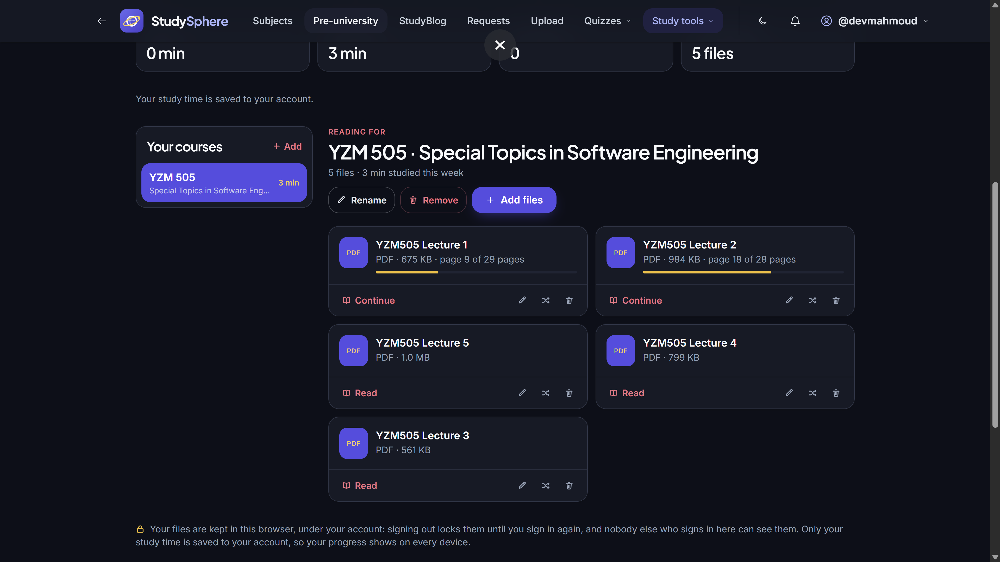
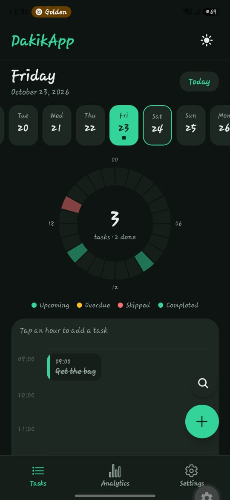
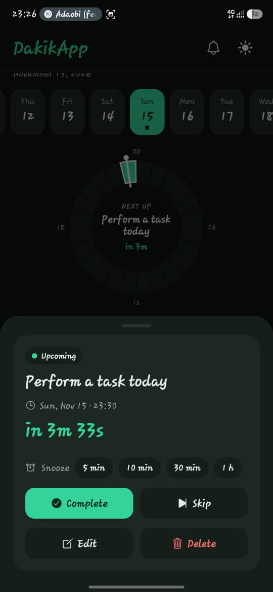
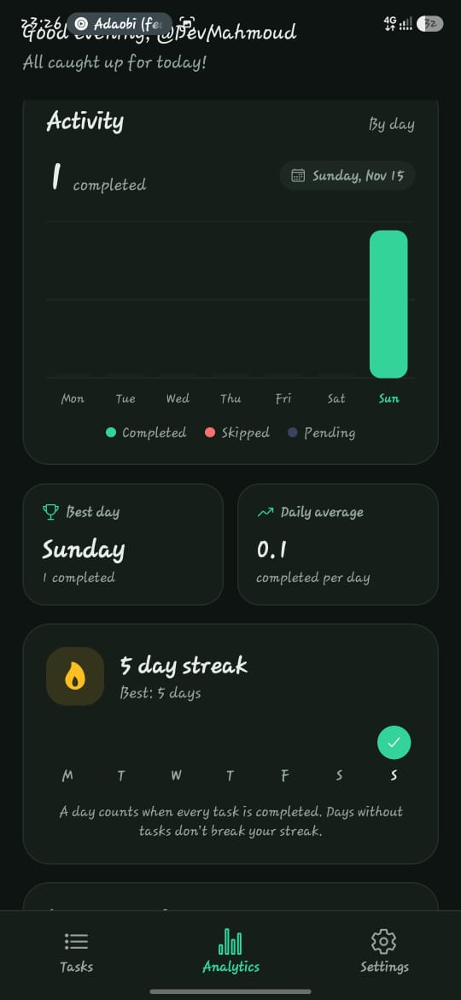

<!-- ============ HEADER ============ -->

 

 

---

## 👋 Hi, I'm Mahmoud

I'm a full-stack engineer who builds whole products: the database, the backend, the UI, and the admin tools nobody sees. I care a lot about software that still works when the network is bad, the phone is cheap, and the data plan is nearly empty.

Right now I'm building two products of my own, one web and one mobile. I'm open to **remote roles** and **freelance projects**.

---

## 🧰 Tech I work with

  

---

## 🚀 What I'm building

### 📚 StudySphere: a free study library for Nigerian students

<!-- Add a screenshot or GIF here: 2–3 phone screens side by side work best. -->

  

Every semester, students across Nigeria hunt for the same handouts and past questions. They're buried in expiring WhatsApp groups or sold by photocopy vendors. **StudySphere puts them in one free, searchable library**, organised by institution, course and subject, for university students and for secondary students preparing for JAMB, WAEC and NECO.

I designed and built it end to end as founder and lead developer at SpaceSoftwares LTD. It's built and tested, and it's heading for a soft launch at Federal University Dutse.

  
  
  
  
  
  

**What students get:** a library of notes and past papers covering 778 institutions, timed quizzes with leaderboards, flashcards with spaced repetition, exam countdowns, a GPA calculator, a Q&A board, and a requests board that notifies you when someone uploads the paper you asked for.

<b>🔧 Engineering highlights (click to expand)</b>

 

- **No framework, on purpose.** I wrote the core layer myself: database access, sessions, security helpers and mail, organised into core, handlers, modules and views.
- **Safe data access.** Every query goes through `mysqli` prepared statements over a `utf8mb4` connection. Schema changes are tracked as migrations and seeds.
- **Works offline.** A service worker, a web app manifest and an offline study mode, so students can revise without data. App icons are generated by a build script.
- **Documents open in the browser, with nothing to download.** PDFs render with PDF.js, Word files with docx-preview + JSZip, maths with KaTeX and code with highlight.js.
- **Data-light.** File sizes are shown before every download, large PDFs are compressed, and long lists load as you scroll.
- **Security.** Rate-limited sign-in, hardened file uploads, email verification, secure admin sessions, and a privacy policy written for Nigeria's NDPA 2023.
- **Reliable email.** PHPMailer sends over SMTP and falls back to PHP's `mail()` when SMTP isn't configured.
- **Lean frontend build.** Tailwind compiles to a single CSS file. Node is only used at build time and never runs on the server.
- **SEO built in.** Sitemaps, structured data, link previews, and course pages that match how students search ("MTH 101 past questions").
- **A full admin console** with analytics, moderation, reports and campus-rep management.

> 🔒 The code is private. I'm happy to walk you through the architecture on a call.

---

### ⏰ DakikApp: reminders that actually arrive on time

<!-- Add a screenshot or a short screen-recording GIF here. -->

   
  &nbsp;
  
  &nbsp;
  

*"Dakik"* is Turkish for punctual. Most reminder apps go quiet on silent mode, arrive late on Android, and treat being late as failure. **DakikApp is a cross-platform task and reminder app built around one promise: never miss what matters.**

  
  
  
  
  
  

- 🔔 **On time, every time.** Exact alarm scheduling that works whether the app is open, closed, or the phone is locked.
- 🗣️ **Talking reminders.** A chime and a spoken alert ("There are 10 minutes to your next activity") that plays even on silent, designed with visually impaired users in mind.
- ⏰ **Up to five reminders per task**, follow-ups if a task isn't done, and task durations with a "time's up" alert.
- 🙂 **Late-friendly.** If you start late, the task stays open, and missed tasks can still be completed.
- 📊 **Calendar and list views**, streaks, analytics and a notification inbox.
- ☁️ **Offline-first** with SQLite, plus cloud backup with Google sign-in through Supabase.

<b>🐛 Problems I solved along the way (click to expand)</b>

 

- **Late, bunched-up Android notifications.** I traced them to inexact alarm scheduling and moved the app to exact alarms, so reminders fire when they should.
- **Duplicate reminders.** I found and fixed the race condition that was scheduling the same reminder twice.
- **Confidence in the core logic.** The scheduling logic is covered by automated tests, so changes don't quietly break reminders.

<!-- When it's public: add a Play Store / App Store / Expo link here. -->

---

## 📈 GitHub activity

<a href="https://git.io/streak-stats">
  <picture>
    <source media="(prefers-color-scheme: dark)" srcset="https://streak-stats.demolab.com?user=develmahmoud&theme=dark&hide_border=true&background=0D1117&ring=4F46E5&fire=4F46E5&currStreakLabel=4F46E5" />
    
  </picture>
</a>

  

<picture>
  <source media="(prefers-color-scheme: dark)" srcset="https://raw.githubusercontent.com/develmahmoud/develmahmoud/output/github-snake-dark.svg" />
  
</picture>

---

## 🤝 Work with me

**Hiring for a remote team?** I've taken two products from idea to working software on my own: a server-rendered PHP web app and a React Native mobile app. I'm comfortable owning a feature end to end, and I write down what I've done.

**Need something built?** I take freelance work on web apps, mobile apps, dashboards, APIs and business websites. Tell me what you're trying to do, and I'll tell you honestly how I'd build it and how long it will take.

📫 The fastest way to reach me is **[email](mailto:sanimahmoud10@gmail.com)** or **[LinkedIn](https://linkedin.com/in/sanimahmoud)**. I usually reply within a day.

<!-- ============ FOOTER ============ -->

